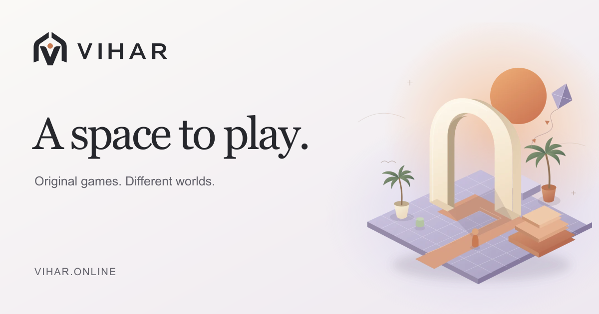

<div align="center">

<picture>
  <source media="(prefers-color-scheme: dark)" srcset="public/brand/vihar-horizontal-inverse.svg" />
  
</picture>

# A space to play.

Discover original games. Explore independent worlds. Take your player identity with you.

[Explore Vihar](https://vihar.online) · [Community games](https://vihar.online/games/community) · [Creator studio](https://vihar.online/dashboard/publish) · [Help & support](https://vihar.online/help)

[](https://github.com/tirthankardgen-cell/Vihar/actions/workflows/ci.yml)
[](LICENSE)



</div>

## One platform. Many ways to play.

Vihar brings **VIHAR Originals** and **Community Games** into one place to discover, play and share. Players build an identity across participating games. Creators publish their own hosted games, explain how to play and learn from player feedback.

| Players | Creators |
| --- | --- |
| Discover original and independent games | Publish browser or downloadable game listings |
| Use one Vihar ID across connected game websites | Add a recognizable **Sign in with Vihar ID** button |
| Keep recorded play activity and supported saves together | Connect game-scoped identity, cloud saves and session reporting |
| Save favourites, connect with friends and review games | Manage drafts, screenshots, play guides, reviews and aggregate activity |

Games remain on their creators' hosting. Games with accounts or saved progress use Vihar ID on their own websites; direct-play games open without an in-game login. Connected games report actual gameplay separately from website opens.

[Meet Bap Ka Rasta](https://vihar.online/games/bap-ka-rasta) · [Play Gulam Chor](https://vihar.online/games/gulam-chor) · [Integrate Vihar ID](https://vihar.online/help/browser-sdk) · [Button & icon guide](https://vihar.online/help/brand-button)

## Develop locally

Use **Node.js 26.x** and npm. **Java 21+** is required for Firebase emulator tests.

```sh
git clone https://github.com/tirthankardgen-cell/Vihar.git
cd Vihar
npm ci
cp .env.example .env.local
npm run dev
```

Open [localhost:3000](http://localhost:3000). On PowerShell, use `Copy-Item .env.example .env.local`. Configure account services using [.env.example](.env.example), or follow the [isolated emulator setup](development.md#local-development). Local environment files are never committed.

## Work with confidence

```sh
npm run check:log         # Required development record for your change
npm run check             # Lint, unit tests, types and production build
npm run test:rules        # Firestore authorization
npm run test:integration  # Identity, saves and gameplay service contracts
npm run verify            # Built routes, assets, SEO and policy checks
```

GitHub Actions checks each pull request and push to `main`. Production runs on the existing Vercel project; Firebase rules are deployed separately when required. A release is complete only after its exact commit passes checks and its production deployment is verified.

## Project reference

**[development.md](development.md) is the single technical reference and change log.** It covers architecture, configuration, Vihar ID, data boundaries, assets, testing, deployment, decisions and historical evidence.

Every agent and contributor must read [AGENTS.md](AGENTS.md) and update the development record with **what changed, why, decisions, validation and release status** in the same change. CI checks this requirement.

| Location | Purpose |
| --- | --- |
| `src/` | Application routes, interfaces and domain services |
| `public/` | Production artwork, fonts, official icons and the Vihar ID SDK |
| `assets/` | Original artwork and reusable asset inputs |
| `scripts/` | Automated verification and asset generation |
| `.github/` | Quality gates and contribution templates |

Built with Next.js, React, TypeScript, Firebase and Vercel.

## Support and ownership

For player and creator help, visit [Help & support](https://vihar.online/help). For account assistance, usage permission or private security reports, contact [contact@vihar.online](mailto:contact@vihar.online). Follow the [reporting guidance](development.md#security-and-support) and keep private information out of public issues.

Vihar is proprietary. Public source access does not grant a general redistribution license. Studios integrating Vihar ID may use the official icons in sign-in buttons under the limited integration permission in [LICENSE](LICENSE). Third-party assets and libraries retain their licenses and [attributions](THIRD_PARTY_NOTICES.md).
